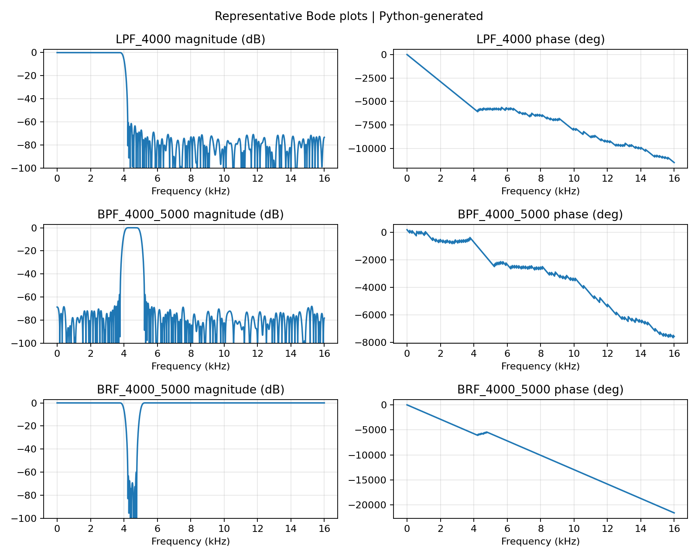
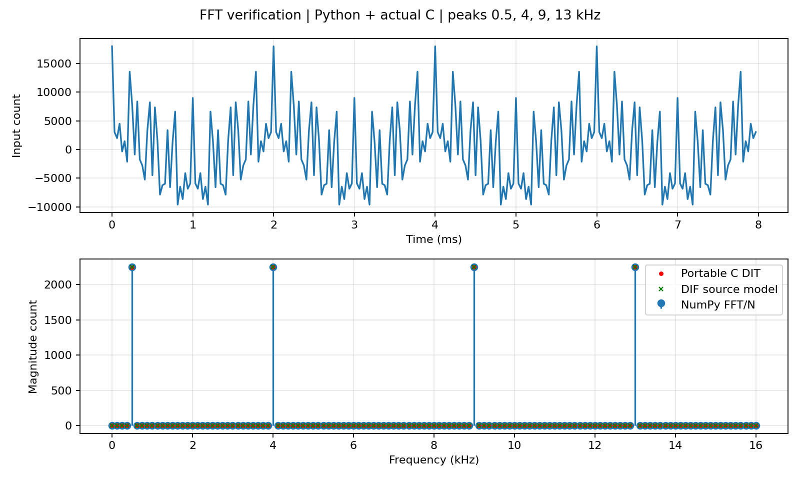
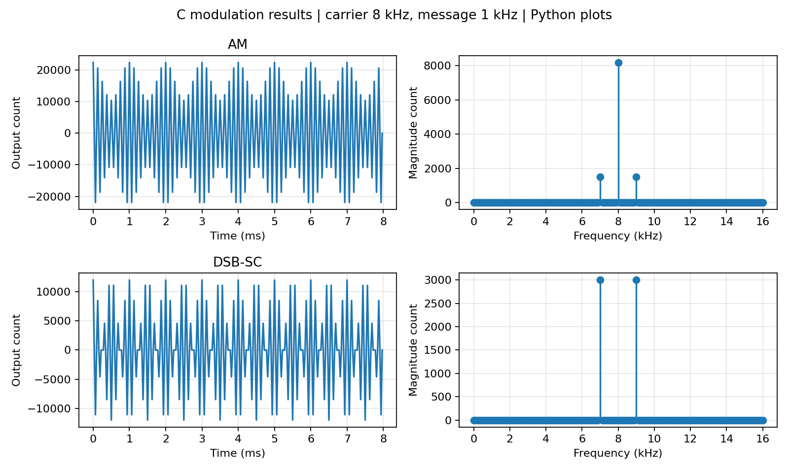
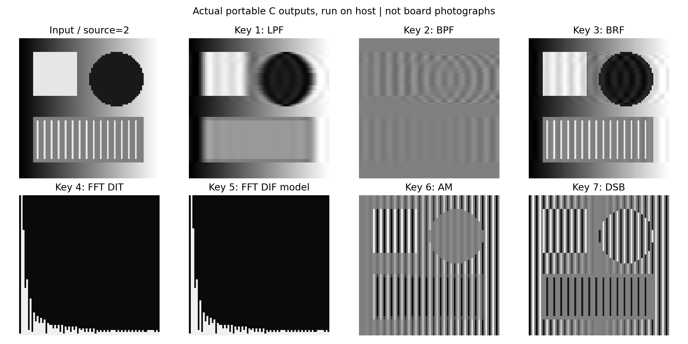

# 基于 C5509 原工程的可切换数字滤波、FFT 与 AM/DSB 演示系统设计

南京农业大学　数字系统综合设计课程报告

学院：人工智能学院　　专业：电子信息科学与技术

姓名：____________　学号：____________　班级：____________

组员：____________　指导教师：____________　提交日期：____________

版本说明：本稿依据所提供的评分标准与课设要求编写，采用通用课程报告版式；未提供的学校专用封面需另行套用。算法验证已经执行，目标编译、真实板卡与 FLASH 实验留有待填写记录，不将仿真结果冒充实测。

## 摘要

针对数字系统综合设计中滤波器、快速傅里叶变换与幅度调制的综合训练需求，设计了基于既有 C5509 教学工程的软件系统。系统保留原有时钟、外存初始化及矩阵按键读取路径，使用数字按键选择低通、带通、带阻、两种 FFT 后端以及 AM、DSB 调制，并以图像缓冲区和数值信号缓冲区展示结果。滤波模块采用采样率 32 kHz、257 抽头 Kaiser 窗 FIR 结构，提供 28 组 Q15 系数，覆盖 1—10 kHz 的截止频率及相邻带通、带阻频带。FFT 模块采用 256 点基二算法，分别实现 DIT 与 DIF 描述，逐级缩放并对特殊旋转因子作精确处理；DIF 后端提供生成 C55x 汇编后再汇编链接的构建流程。调制模块使用 1 kHz 消息与 8 kHz 载波，比较载波存在与抑制情况下的频谱差异。主机端以相同便携 C 源码执行独立参考验证，61 项检查全部通过，全部滤波器的最差阻带衰减约为 57.57 dB，最大通带波动约为 0.0196 dB。设计同时给出图片转换、CCS 内存导入导出、虚拟机使用及 Matlab 仿真步骤，为后续实际板卡联调提供可复现基础。

关键词：C5509；FIR 滤波器；定点 FFT；AM；DSB；图像显示

## Abstract

A configurable digital signal processing demonstration system is developed from an existing C5509 educational project. The original clock, memory initialization and keypad interfaces are retained. Numeric keys select low-pass, band-pass and band-reject FIR filtering, two FFT backends, and AM or suppressed-carrier DSB modulation. Twenty-eight banks of 257-tap Q15 coefficients are designed at a sampling frequency of 32 kHz. Independent radix-2 DIT and DIF formulations provide normalized 256-point transforms, with stage scaling and exact handling of unity and quadrature twiddle factors. The DIF source can be translated into C55x assembly and assembled again through the supplied target build procedure. Modulation experiments use a 1 kHz message and an 8 kHz carrier. Native execution of the portable C sources passes 61 final checks against independent numerical references. The worst stopband attenuation of the quantized filter banks is approximately 57.57 dB, and the maximum passband ripple is approximately 0.0196 dB. Image conversion, debugger-based memory exchange, virtual-machine operation and MATLAB simulation scripts are included. Native algorithm validation is distinguished from target compilation and physical-board experiments, which require the actual hardware and toolchain.

Keywords: C5509; FIR filter; fixed-point FFT; AM; DSB; image visualization

## 1　研究背景与设计任务

### 1.1　研究背景

数字信号处理系统将离散数学模型、有限精度运算和实际设备接口结合起来。同一个滤波表达式在理论推导中只涉及卷积，在 DSP 上却还涉及字长、累加器范围、存储段位置以及结果观察方式。课程设计的价值在于建立这些环节之间的对应关系，使频域分析能够指导参数选择，也使实际程序的输出能够被独立方法复核。滤波、频谱分析与幅度调制分别体现频率选择、时频变换与频谱搬移，把三者组织在同一按键程序中，有利于比较不同操作对同一输入的影响。数字系统与滤波原理可参考文献[1-2]。

既有程序提供了 80×80 图像缓冲区与数字按键读取接口，原先按键 1、2 产生内置图并执行 Sobel，其他若干键控制发光器件。这一基础已经包含可复用的板级入口，但尚未覆盖本次选定的滤波器、FFT 和 AM/DSB 任务。因此，本设计以保留可识别硬件路径为前提改造应用层，增加明确的参数状态、可观察的完成标志和主机辅助工具，使算法结果有稳定的查看入口。

### 1.2　任务边界与平台依据

基础部分选取 FIR 滤波器和 FFT，专业部分选取 AM、DSB 调制；实践目标是完成对应开发系统的编译、连接、下载与运行验证。评分文件要求正文不少于 5000 字、原则上不超过 10000 字，并包含中英文摘要及规范图表。所提供文件属于评分标准，没有附带教务处专用报告模板，因此本稿先按通用课程设计结构组织，最终提交时应套用教师指定封面。

平台识别依据是原 Key.pjt 的 TMS320C55XX 设置、构建日志中的 cl55、C55x 运行库以及 ICETEK-VC5509 寄存器映射。这些证据一致指向 C5509 教学平台。另一份附件名称包含 DSP28335，但因文件超过当前传输上限尚未读取，实物型号也没有得到确认。故本报告讨论原 C5509 工程的软件实现，不把它宣称为 F28335 工程。物理下载前必须核对板型；若实际使用 F28335，应重新完成板级移植。

## 2　总体方案与数据组织

### 2.1　模块划分

系统由按键状态机、图源管理、FIR 运算、FFT 运算、调制运算和主机显示工具组成。主循环先完成原 PLL、SDRAM 与控制板初始化，再读取按键。按键 1—7 对应低通、带通、带阻、C DIT FFT、DIF 汇编构建后端、AM 与 DSB；按键 8 修改截止频率索引，按键 9 修改图源。无效按键不发布新结果，避免在无操作时重复覆盖可观察数据。

数据流为“选择图源—装载输入—执行当前模式—填写结果状态—发布完成点”。gBusy 表示运算是否进行，gResultSeq 是完成序号，gResultMode 等变量记录与当前缓冲区对应的参数。调试器应在完成点暂停再刷新图像，而不能在卷积尚未写完整时读取整帧。该设计把计算状态与调试器显示状态联系起来，使一次按键操作能够对应一份一致的输出。

### 2.2　图像与一维信号的区分

dbImage 为当前输入，dbTargetImage 为结果，dbUserImage 为预先导入的用户图片；三者均为 6400 个像素元素。内置图源包括条纹与径向渐变，外部图片由主机先灰度化、缩放，再通过 CCS 写入目标内存。DSP 不直接读取宿主文件系统，因而不依赖目标端 fopen 或调试器文件输入输出服务。

图像沿一行排列时属于空间离散信号，其横轴单位是像素，频率单位应写成每像素周期数。课设规定的 kHz 指标则由另一路一维测试信号验证，采样率定义为 32 kHz。系统保留 gSignalIn、gSignalOut 和复数 FFT 数组，将数值实验与图片演示联系起来，同时保留物理意义的区别。图片滤波用于观察平滑、纹理选择和频谱变化，一维信号用于确认截止频率和调制边带。

### 2.3　定点表示与存储安排

C5509 的 char、short 和 int 通常为 16 位，long 为 32 位；普通主机的 char 通常为 8 位。本设计用明确的 16 位样本和 32 位累加类型组织运算，主机构建时使用固定宽度类型，不假设两者的 sizeof 完全相同。图片灰度值仍限定为 0—255，但在目标端每个像素占一个 16 位存储字，主机 .dat 工具据此输出 6400 个字。

原工程把较多数据放在 DARAM2，新增加的系数表与用户图会加大占用，因此链接配置把大数组、常量和初始化数据安排到片内 SARAM，堆栈保留在 DARAM2。系数表共有 28×257=7196 个定点字，三幅图片共 19200 个像素字，四个 256 点信号/复数分量数组共 1024 个字。这一规模要求在真实目标 map 中核对，而不能只根据主机编译成功判断 DSP 内存足够。

## 3　FIR 滤波器设计

### 3.1　采样率与截止频率方案

最大设计边缘为 10 kHz，选择 32 kHz 采样率后奈奎斯特频率为 16 kHz，能够为最高截止边缘及过渡区留出空间。采样率过低会使高频边缘接近折叠点，过高则需要更多抽头实现同样绝对过渡宽度，因此本设计在可观察频带与实现规模之间取中间值。这里的采样率用于离线离散信号实验，不表示已经接通实际 ADC。

低通设置十组截止频率，分别为 1、2 至 10 kHz。带通和带阻必须同时给出两个边缘，不能只用一个截止值完整定义；因此把相邻频率组成 1—2、2—3 至 9—10 kHz 的九个频带。这样共得到十组低通、九组带通和九组带阻，覆盖题目给出的边缘序列，又保持按键参数有明确含义。若教师另有指定带宽，可在该设计方法下重新生成表，而不应擅自把两个边缘当作中心频率。

### 3.2　窗函数法与线性相位

有限冲激响应滤波器的输出为 y[n]=Σh[k]x[n−k]，求和范围为 0 至 L−1。设 L=257、中心 M=128，理想低通的非中心抽头可表示为 sin(2πfc(k−M)/fs)/(π(k−M))，中心值为 2fc/fs。带通由两个理想低通相减得到，带阻则由单位冲激减去对应带通。理想响应无限长，需乘有限窗才能形成可实现系数。

Kaiser 窗通过修正贝塞尔函数构造，窗函数分析参见文献[4]，形状参数取 5.65326。对称窗与对称理想响应相乘后保持 h[k]=h[L−1−k]，因此未量化响应为奇数长度线性相位 FIR。正常通过的频带具有固定群延迟 M/fs=4 ms。相比引入极点的递归结构，该实现没有反馈稳定性问题，且系数与边界运算比较容易检查，适合同时用于教学和图像逐行演示。

### 3.3　过渡带和量化指标

本设计把总过渡带宽定义为 500 Hz，以理想截止边缘为中心，两侧各留 250 Hz。例如 4 kHz 低通在 3.75 kHz 以内统计通带，在 4.25 kHz 以外统计阻带。4—5 kHz 带通在 4.25—4.75 kHz 统计通带，在 3.75 kHz 以下及 5.25 kHz 以上统计阻带。截止边缘附近约为 −6 dB，不属于阻带验收位置。

浮点设计系数乘以 32768 后四舍五入为 Q15 整数，实际系数为整数除以 32768。量化会改变阻带纹波，故不能把窗参数对应的理想目标直接写成实际达到的数值。本设计对全部量化后滤波器以密集频率采样计算响应，最差阻带衰减为 57.5688 dB，最大通带峰峰波动为 0.019525 dB；据此把实际检查阈值设为阻带至少 55 dB、波动不超过 0.03 dB。全量结果保存为可读数据文件。

### 3.4　图像边界与显示映射

图像每行只有 80 个点，小于滤波器长度，若直接在图像外补零，会引入强边缘并影响整个短行。程序采用不重复端点的镜像延拓，例如索引 −1 对应 1，索引 80 对应 78，多次反射可处理更远索引。卷积以中心抽头对准当前像素，是离线的居中处理，并非实时因果数据流。因此显示时没有把 128 点延迟表现成整幅图水平移动。

输入先减去 128，把灰度映射到有符号范围，再与定点系数相乘，32 位累加后恢复灰度中心并限幅到 0—255。带通去除直流后，平坦区域接近 128，属于预期的零值表示；不能把灰色输出直接判为程序未运行。测试使用独立的镜像填充与卷积参考，逐像素比较包括边界在内的完整结果，避免只凭肉眼观察确认正确性。

图 1　代表性低通、带通及带阻波特图。全部 28 组幅相图及全部抽头另随数据附件提供。

## 4　快速傅里叶变换实现

### 4.1　算法选择与频率分辨率

离散傅里叶变换为 X[k]=Σx[n]exp(−j2πkn/N)。直接计算需要约 N² 量级运算，基二 FFT 把长度为二次幂的变换分解为蝶形组合，复杂度降低为 Nlog₂N，经典分解思路见文献[3]。本设计取 N=256，既便于与短图像行对接，也使八级蝶形结构易于验证。在 32 kHz 信号采样率下，频率间隔为 125 Hz。

用于信号验证的输入包含 500 Hz、4 kHz、9 kHz 和 13 kHz 四个相干分量，均落在整数频点上，便于区分算法误差与窗函数造成的泄漏。图像模式取中间一行 80 点，去中心并缩放后补零至 256 点。补零增加了绘图采样密度，不增加原始 80 点数据所含的信息，也不能被解释为实际频率分辨能力凭空提高。

### 4.2　DIT 与 DIF 的独立结构

C 版本采用时间抽取 DIT：先按位反转输入，再按 2、4 至 256 的跨度进行蝶形，输出为自然顺序。另一版本采用频率抽取 DIF：先以 256 点跨度进行和差运算，逐级减小跨度，最后对输出做位反转。两种结构在数学上相同，但舍入位置不同，因此定点结果允许存在几个整数计数的差别。

本交付为 DIF 提供完整的独立源描述和目标构建流程。构建时由 TI 编译器输出 C55x 汇编，再把生成的汇编文件作为实际输入重新汇编链接。其性质是编译器生成汇编，不是手写优化汇编。云端尚未取得可用的 TI 工具链，因而没有宣称真实 .asm 已生成、汇编已通过或目标周期已经测量。若课程把“汇编实现”限定为手写源程序，该要求仍需补充，不能仅凭构建路径视为已满足。

### 4.3　逐级缩放与特殊旋转因子

定点蝶形存在幅度增长风险。本实现每级输出除以二，八级累计归一化为 1/256，因此独立参考使用 fft(x)/256。若直接与未缩放的 FFT 比较，会人为得到 256 倍的幅值差。乘法使用 32 位中间结果，量化和限幅集中在明确位置，减少不同编译器对整数运算的解释差异。

Q15 可以表示 −1，却不能精确表示正 1。若把单位旋转因子也写为 32767/32768，直流样本会在每级受到微小衰减。初次验证发现了这一误差，修正为对旋转因子 1 和 −j 直接执行复制或实虚部交换后，零输入、冲激、直流和奈奎斯特模式都能得到准确的预期值。对其他旋转因子保留正常量化，并把误差以整数计数记录，而不只写“图像相同”。

### 4.4　频谱显示方式

精确 FFT 结果保存为实部和虚部数组，主机计算平方和开方得到复数幅值。为了让目标上的 80×80 窗口能够快速显示，预览采用实部绝对值与虚部绝对值之和，并把相邻频点的峰值映射为柱高。该预览可用于观察谱峰位置，却不是精确幅值刻度；定量结果应读取原始复数数组，不能由小图柱高反推绝对增益。

图片谱图的横轴应为 cycles/pixel；独立时间信号谱图才使用 kHz。该区分也适用于报告答辩：第 4、5 键展示的是一维图像行的频谱，不是完整二维 FFT，更不是经过频域滤波后重建的图片。若进一步做二维变换，需要增加列方向处理和逆变换，本次实现没有把这些扩展内容写成已完成成果。

图 2　相干多音输入及归一化频谱。DIT 为实际主机 C 执行，DIF 为待生成目标汇编的独立源模型。

## 5　AM 与 DSB 调制设计

### 5.1　数学模型

普通调幅可写为 sAM(t)=[Ac+μm(t)]cos(2πfct)，双边带抑制载波调制为 sDSB(t)=m(t)cos(2πfct)，有关频谱搬移原理参见文献[5]。当消息为单一余弦时，乘积展开产生 fc−fm 与 fc+fm 两个边带；普通 AM 还包含载波频率 fc 的分量。两种模式在相同消息、相同载波下比较，可以直接体现载波能量保留与抑制的区别。

程序取消息频率 1 kHz、载波 8 kHz，采样率 32 kHz。载波采样序列为正、零、负、零的四点循环，避免逐点计算三角函数。Q15 载波幅度取 32767，消息峰值为 12000；AM 内部使用 16384 的直流载波基项，加上消息的一半，再乘载波。消息造成的变化小于直流基项，不会出现包络反向的过调制情况。

### 5.2　频谱与图像观察

在 256 点相干采样下，消息对应第 8 个频点，载波对应第 64 个频点，两个边带在第 56 与第 72 个频点，即 7 kHz 和 9 kHz。验证既检查边带对称性，也检查 AM 中 8 kHz 分量明显存在、DSB 中该分量接近零。仅检查总能量变化不能区分两种调制，这也是选择频谱作为主要验收证据的原因。

图片演示把同一行灰度样本作为消息，沿列方向乘相同周期载波，结果恢复到灰度中心显示。因此可见条纹或纹理变化，但这只是一种样本运算可视化，不代表已经把图片通过真实通信链路发送和接收。本设计没有接入射频通道、载波同步或解调模块，报告也不据此声称完成完整图像通信系统。

图 3　AM 的载波与双边带、DSB 的双边带分布。

## 6　程序运行与主机交互

### 6.1　按键与状态发布

原程序在图像处理后使用较长延时，新增程序改为运算结束发布序号，再返回按键循环。模式和频率索引分别保存，切换到带通或带阻时把索引规整到九个合法频带内。按键 9 只在已设置用户图片就绪标志时才把用户图加入轮换，避免首次进入未初始化数据。

gCommand 允许通过调试器写入 1—9 触发同样的应用逻辑，主要用于区分算法问题与按键硬件问题。它并不替代物理按键验收；最终仍需检查真实 GetKey 返回值、键码与输出的对应关系。完成断点与序号配合使用，可以确定一次刷新来自当前操作，避免误读先前保留在窗口中的旧图。

### 6.2　图片加载与结果显示

用户原图先在主机由 Pillow 转为灰度并缩放到 80×80，再写为 CCS 十六进制文本。装载目标为 dbUserImage 的实际符号地址，文件头中的地址零只作占位，必须覆盖；不能把数据写进地址零。导入后设置 gUserImageReady，再选择用户图源并运行处理，下一次装载不会覆盖这一缓冲区。

观察结果优先使用 CCS 的图像工具；若版本没有相应插件，则保存源图与结果各 6400 个目标字，主机查看器读取导出的 .dat 并刷新。查看器每隔短时间检查文件是否改变，但不具备自动 JTAG 读取能力，所以每帧仍需在目标完成后由 CCS 导出。这个交互流程与现有代码的能力相符，没有引入未经实现的串口协议。

## 7　验证方法与结果分析

### 7.1　独立参考与测试覆盖

环境验证在 Linux 中实际编译同一组便携 C 源码，以 GCC 的严格警告设置和 C89 模式构建。滤波器频响使用独立频率响应计算，图像卷积使用独立镜像填充与数值卷积，FFT 与 NumPy 的复数结果比较，调制则检查特定频点。测试还覆盖零输入、冲激、直流、奈奎斯特模式、随机实数及复数输入，避免只用一张看似正常的图来判断算法。

61 项检查全部通过。零、冲激、直流及奈奎斯特输入在两种 FFT 源实现下的最大复数误差均为零；其他所测向量的最大误差低于六个整数计数，其中 C DIT 的随机输入约为 3.8321，DIF 源模型约为 2.5257。这些数据适用于测试的幅度范围与缩放约定，不应推广成任意满幅复数输入均无饱和的结论。

### 7.2　图像结果解释

示例输入包含渐变、几何边缘和细条纹。低通使高频纹理减弱，带通保留选定空间变化并去除大部分直流，带阻抑制对应纹理频段。因为显示采用有符号中心恢复，带通平坦区呈中灰色；因为 FIR 有有限过渡带，边缘附近可能出现振铃。这些现象需要结合幅频响应解释，而不能简单地用“图像更清晰”概括所有滤波作用。

FFT 两种后端的图像预览整体一致，定量差异来自蝶形顺序与舍入。AM 与 DSB 的纹理图仅作运算效果展示，独立信号频谱则给出载波和边带的严格位置。主机执行结果与物理板图像应分别保存，文件中明确标注数据来源，以免论文图注混淆。

图 4　相同用户图片的七种模式输出；本图不是开发板实拍或 CCS 硬件截屏。

### 7.3　Matlab 与目标验证状态

Matlab 脚本独立实现窗函数设计、Q15 量化、DIT/DIF 模型与调制，可输出全部 28 组幅相图、复数 FFT 对照及调制图，不依赖信号处理工具箱。随交付提供的 Python 图有明确来源，不能改写为已经运行 MATLAB 的结果。实际 MATLAB 执行后，应保留解释器版本、完整完成标记和本地输出，将相应图替换到最终报告。作为兼容性补充，已在 GNU Octave 9.4.0 中完整运行同一脚本，实际产生 30 张图及数值文件；全部 Q15 系数与交付表逐项一致，DIT、DIF 模型与对应主机 C 输出的整数差均为零。此记录保存在 octave_output，来源保持为 Octave。

目前目标编译器获取受网络策略限制，云端也没有实际开发板。故主机 C 验证、脚本兼容性验证、TI 目标汇编、JTAG 下载与 FLASH 脱机运行是不同层级，后两层尚不能填写“通过”。这种状态区分使已验证部分可以复现，也使后续实验知道具体还需要补充什么证据，而不是把未完成事项笼统写成整个系统失败或全部成功。

## 8　虚拟机与硬件实践方案

### 8.1　宿主与客体的分工

若已有 Windows XP 虚拟机及可用的 CCS 3.3，应把它用于旧下载器与原工程；现代 Python 和图像查看器则放在 Windows 10/11 宿主或现代 Ubuntu 中。共享目录用于传递图片和导出结果。USB 下载器应连接到运行 CCS 的系统，同一时间避免宿主、客体同时占用。实际 USB 控制器版本和驱动选择必须依据下载器型号，不能从本报告推断硬件属于某一种 XDS 系列。

若客体实际为 Ubuntu，可以运行主机算法与脚本，但不能把 Windows 驱动或 exe 当作原生 Linux 程序使用。应先通过系统版本页面、板卡丝印、CCS Setup 和设备管理器恢复真实配置，再决定是否继续沿用旧虚拟机。整个流程不要求用户先重新安装操作系统，也避免破坏已有工作环境。

### 8.2　目标编译、下载与固化记录

目标构建采用原有大存储模式，先生成 DIF 汇编，再编译其他源文件并链接新版 course_design.out。须检查退出码、警告及 map，确认汇编源实际参与链接、各段位于合法区域后，再由匹配的目标配置装载。运行到完成断点后观察序号及图像，逐一测试七种功能、全部参数循环和用户图导入。

JTAG 向 RAM 下载并不等于固化 FLASH。FLASH 实践还需确认具体器件、厂商工具、启动开关、编程与校验结果，并在断开 JTAG、断电重启后复测。由于这些资料尚未提供，本报告仅给出验收表，真实实验结果、耗时和故障处理由实际操作者补填。若实物是 F28335，还必须先完成独立移植，不能执行本 C5509 下载步骤。

## 9　局限、改进方向与结论

本设计采用按键触发的整帧运算，没有完成 ADC/DAC 实时流、DMA 双缓冲和可测的实时调度。257 抽头逐行卷积具有一定计算量，原 Delay 的数值不能用于推断帧率。后续若需提高性能，可在真实目标计时后利用系数对称性减少乘法、改进缓冲组织，并针对处理器指令集优化热点，再以相同独立参考确认优化没有改变功能。

汇编路径当前由编译器生成，距离手写调优的完整 FFT 仍有区别。进一步工作包括取得目标工具链、核对实际板卡、完成真实汇编与硬件验证，以及在教师要求下提供手写版本。图像处理若需要二维效果，可扩展到二维频域设计，但需同时考虑额外内存、逆变换和幅度归一化，不能只把一维预览更名为二维系统。

已完成的软件部分把原按键工程转化为可选择滤波、频谱分析和幅度调制的应用框架，提供了完整系数、确定的定点规则、可复核的主机数值结果及操作流程。其主要收获是建立算法参数、有限精度、存储布局和观察方法之间的联系。最终课程报告应在本稿基础上补入本人完成的 MATLAB 与硬件实验记录，并用真实证据确认实践目标。

## 参考文献

[1] Oppenheim A V, Schafer R W. Discrete-Time Signal Processing. 3rd ed. Pearson, 2010.

[2] Proakis J G, Manolakis D G. Digital Signal Processing: Principles, Algorithms, and Applications. 4th ed. Pearson Prentice Hall, 2007.

[3] Cooley J W, Tukey J W. An algorithm for the machine calculation of complex Fourier series. Mathematics of Computation, 1965, 19(90): 297–301. DOI: 10.1090/S0025-5718-1965-0178586-1.

[4] Harris F J. On the use of windows for harmonic analysis with the discrete Fourier transform. Proceedings of the IEEE, 1978, 66(1): 51–83. DOI: 10.1109/PROC.1978.10837.

[5] Proakis J G, Salehi M. Digital Communications. 5th ed. McGraw-Hill, 2008.

[6] 用户提供的 v61.zip：Key.pjt、cc_build_Debug.log、ICETEK-VC5509-A.cmd 及板级源文件，原始版本见随附压缩包。

[7] 数字系统综合设计课程论文评分标准；南京农业大学实习计划表：要求及内容。用户提供的课程资料。

## 附录 A　随附数据与复现入口

滤波器全量系数：results/filter_coefficients.csv，含 7196 行抽头数据。全部滤波器指标：results/filter_specs.json。完整验证记录：results/validation.json。代表性数值输出：results/fft_c_and_dif.csv、am_c.csv、dsb_c.csv。全部幅相图：results/figures/all_28_bode_Python.pdf。Matlab 复现入口：matlab/run_all.m。目标工程入口：v61/Key.pjt 与 v61/build_c55x.bat。

## 附录 B　实践补充页

实际板卡型号：____________　目标编译版本：____________

MATLAB 版本与运行日期：____________　结果文件位置：____________

目标构建日志、内存检查：____________

物理按键及图像刷新实测：____________

FLASH 编程、校验与断电重启：____________

本人实际遇到的问题、解决过程与体会：____________
